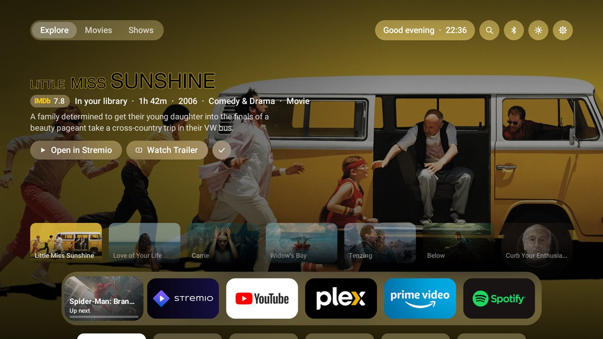
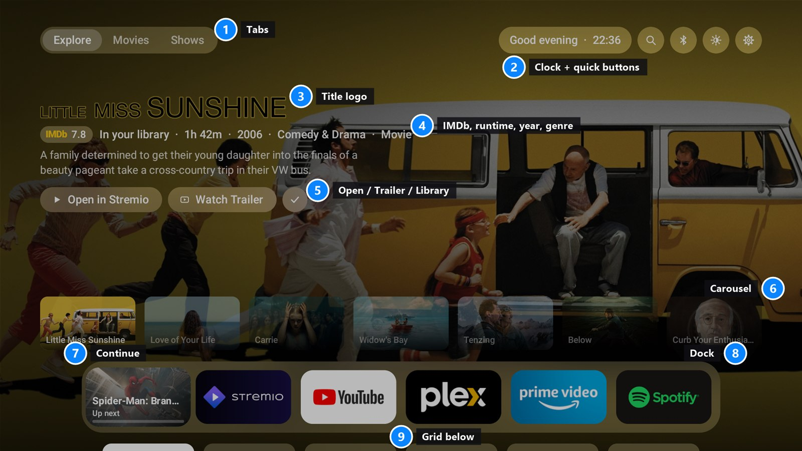
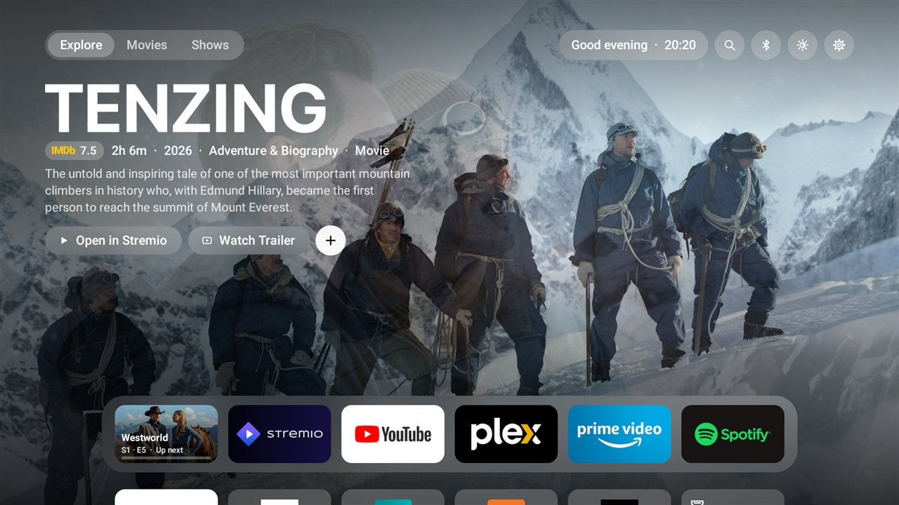
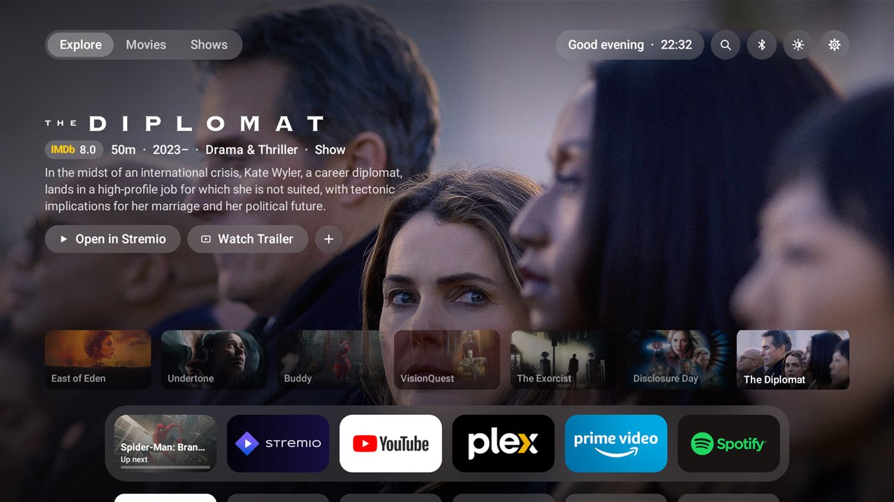
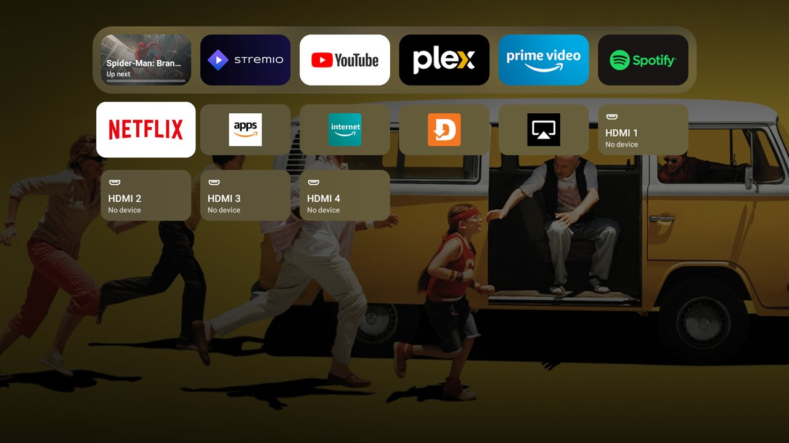
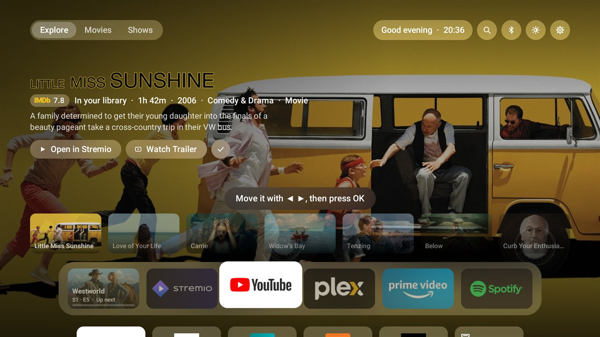
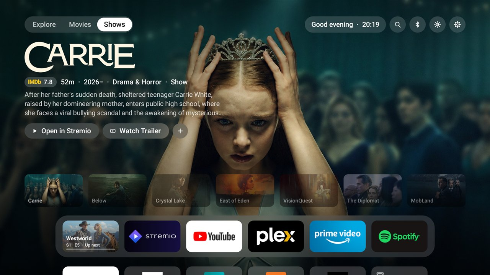
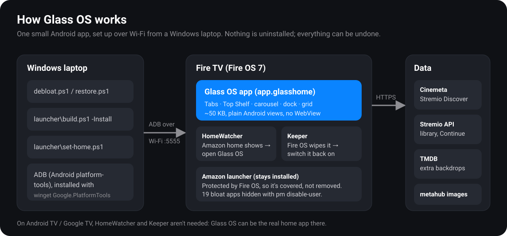

# Glass OS

**A fast, minimal, Apple TV-style home screen for Fire TV, plus a reversible debloat kit.**



Glass OS replaces the ad-filled Fire TV home screen with a clean "Liquid Glass" one:

- a Top Shelf showing what's popular in Stremio, with HD art, IMDb rating, runtime and a blurb
- a carousel you can browse
- a dock for your apps that you can rearrange
- your HDMI inputs one press away

The whole app is about **50 KB**, against **27 MB** for Amazon's launcher. It runs smoother and uses less memory in the background.

## Pick your guide

| | Guide | What you get |
|---|---|---|
| 🔥 | **[Fire TV guide](docs/FIRE-TV.md)** | Debloat a Fire TV (ads, shopping, telemetry), then install Glass OS and make it the home screen. Tested on a Fire TV 4-Series (Fire OS 7). |
| 📺 | **[Panasonic My Home Screen 3.0 guide](docs/PANASONIC-MY-HOME-SCREEN.md)** | For Panasonic TVs running My Home Screen 3.0 (e.g. TC-49FX700C). That system isn't Android, so this guide runs Glass OS on a streaming stick and sets the TV up around it. |
| 🧭 | **[Porting guide](docs/PORTING.md)** | Bring Glass OS to Android TV / Google TV, other Fire TVs and AOSP boxes, and why Tizen, webOS, Roku and tvOS can't host it. |

## What it looks like



1. **Tabs.** Explore mixes your unwatched Stremio library with what's popular; Movies and Shows come from Stremio's Discover.
2. **Clock and quick buttons.** Search, Bluetooth, brightness slider, settings.
3. **Title logo**, in HD.
4. **An IMDb glass badge**, then runtime, year, genre, and Movie or Show.
5. **Open in Stremio, Watch Trailer**, and **+** to add the title to your Stremio library.
6. **The carousel.** Browse titles; it wraps around at both ends.
7. **Continue.** Resumes the last thing you played in Stremio, with a progress bar.
8. **The dock.** Hold OK on an app to rearrange it.
9. **The grid.** Your other apps and HDMI inputs. Move down and the dock rises to the top.

| | |
|---|---|
|  **Top Shelf.** On the buttons, the carousel steps aside and the background cycles through more HD stills of the title. |  **Carousel.** Seven titles, aligned edge to edge, with names on the art. |
|  **Grid.** Other apps and HDMI inputs, with the dock lifted to the top. |  **Rearranging.** Hold OK, move with ◀ ▶, press OK to drop. |
|  **Shows tab.** Movies and Shows come from Stremio's Discover. The **+** turns into ✓ once a title is in your Stremio library. | |

## How it works



- **One Android app, no libraries, no WebView.** It's built without Gradle by `launcher/build.ps1`, then compiled ahead of time on the TV.
- **Home button and boot.** Fire OS locks its own launcher in place, so a small accessibility service, *HomeWatcher*, sends Home to Glass OS. A second piece, *Keeper*, switches it back on if Fire OS ever resets accessibility settings. On Android TV and Google TV neither is needed (see the [porting guide](docs/PORTING.md)).
- **Debloat** uses `pm disable-user`. Nothing is uninstalled, and `restore.ps1` undoes it.

### Measured on a Fire TV 4-Series

| | Amazon launcher | Glass OS |
|---|---|---|
| App size | 27.3 MB | **~50 KB** |
| Pressing Home from an app | n/a | **0.13–0.3 s** |
| Janky frames while browsing | n/a | **~0.1%** once warm |
| Memory with another app in front | ~113 MB | **~100 MB** |

## Repository layout

```
├── debloat.ps1 / restore.ps1   hide or restore Fire TV bloat (reversible)
├── bloat.txt                   the hide list, in tiers
├── FireTV-apps.md              all 266 packages on a Fire TV 4-Series, classified
├── launcher/                   Glass OS source
│   ├── src/app/glasshome/      Main.java (UI), HomeWatcher.java, Keeper.java
│   ├── AndroidManifest.xml
│   ├── build.ps1               build (and -Install) without Gradle
│   └── set-home.ps1            make Glass OS the home screen (-Undo to revert)
└── docs/                       guides, images, project notes
```

## Requirements

- **Laptop:** Windows 10/11 with PowerShell. The scripts are PowerShell. The `adb` commands themselves work anywhere.
- **TV:** a Fire TV on **Fire OS 6 or 7** for the tested path. For Fire OS 8, Android TV and Google TV, see the [porting guide](docs/PORTING.md).
- **Optional:** a **Stremio** account key (library, Continue, Add to Library) and a free **TMDB** API key (extra backdrops). See the [Fire TV guide](docs/FIRE-TV.md#5-optional-connect-your-stremio-library).

## Disclaimer

Glass OS is a personal, unofficial project. It isn't affiliated with or endorsed by Amazon, Apple, Panasonic, Stremio or TMDB. The look is inspired by Apple's tvOS. App banners and title artwork shown in screenshots belong to their owners. Everything it does to your TV can be undone, but you use it at your own risk.
