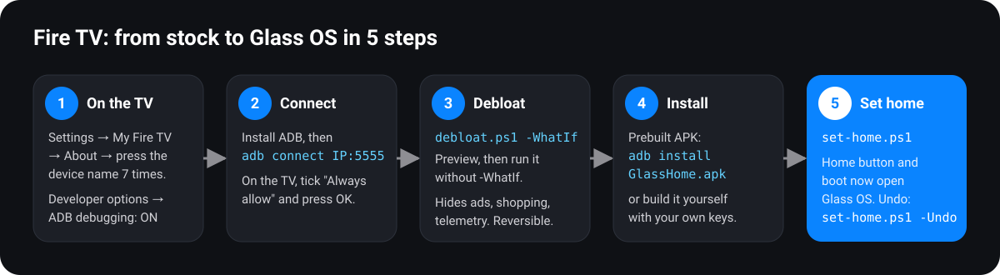

# Fire TV guide: debloat and install Glass OS



This guide takes a stock Fire TV to a debloated TV with Glass OS as its home screen.

- **Time:** about 30 minutes the first time.
- **Reversible:** everything can be undone, and nothing is uninstalled.
- **Tested on:** Fire TV 4-Series (AFTTI43), Fire OS 7.

It should work on any Fire TV, Fire TV Stick or Cube on **Fire OS 6 or 7**. For Fire OS 8, see [PORTING.md §4.3](PORTING.md#43-fire-tv-fire-os-8-android-11-base). Devices on Amazon's **Vega OS** can't run Android apps, so Glass OS won't work there.

> **Find your Fire OS version:** Settings → My Fire TV → About → Fire TV OS / Software version.

**Contents**
1. [Get the files and ADB](#1-get-the-files-and-adb)
2. [Turn on ADB debugging on the TV](#2-turn-on-adb-debugging-on-the-tv)
3. [Connect the laptop to the TV](#3-connect-the-laptop-to-the-tv)
4. [Debloat](#4-debloat)
5. [(Optional) Connect your Stremio library](#5-optional-connect-your-stremio-library)
6. [Install Glass OS](#6-install-glass-os)
7. [Make Glass OS the home screen](#7-make-glass-os-the-home-screen)
8. [Using Glass OS](#8-using-glass-os)
9. [Undo everything](#9-undo-everything)
10. [Troubleshooting](#10-troubleshooting)

---

## 1. Get the files and ADB

On a **Windows 10/11** laptop on the same Wi-Fi as the TV:

1. **Download this repository:** green **Code** button → **Download ZIP**, then unzip it. Or clone it:
   ```bash
   git clone https://github.com/yesmanlab/glass-os.git
   ```
2. **Install ADB** (Google's Android platform-tools):
   ```bash
   winget install Google.PlatformTools
   ```
   The scripts find `adb` automatically, even before you restart the terminal.
3. Open **PowerShell** in the repository folder. Every command below is run from there.

## 2. Turn on ADB debugging on the TV

1. On the TV, go to **Settings → My Fire TV → About**.
2. Highlight your device name (e.g. *Fire TV 4-Series*) and press **OK 7 times**. A message says you're now a developer.
3. Go back to **My Fire TV → Developer options**:
   - **ADB debugging: ON**
   - **Apps from Unknown Sources: ON** (needed for the prebuilt APK on some firmware)
4. Find the TV's IP address: **Settings → My Fire TV → About → Network**. For example `192.168.1.50`.

## 3. Connect the laptop to the TV

```bash
adb connect 192.168.1.50:5555
```
A prompt appears on the TV: **Allow USB debugging?** Tick **Always allow from this computer** and press **OK**. Then check:

```bash
adb devices
```
You should see your TV's address followed by `device`. If it says `unauthorized`, accept the prompt on the TV and run `adb connect` again.

> **Every script takes `-Tv <ip>:5555`.** Pass your TV's address each time, e.g. `-Tv 192.168.1.50:5555`. The default in the scripts is the author's TV.

## 4. Debloat

Debloating hides Amazon's ads, shopping, unused apps and telemetry using `pm disable-user`. Nothing is uninstalled, and `restore.ps1` brings everything back.

The list is in [`bloat.txt`](../bloat.txt), in tiers:

| Tier | What | Default |
|---|---|---|
| 1 | Ads and shopping: Amazon Shopping, Music, Photos, Kids, Games hub, miniTV, ad ID, "Special Offers" ads, content recognition (ACR), Ambient Experience, demo content, tutorials | **On** |
| 2 | Telemetry and logging services | **On** |
| 3 | Alexa and smart-home extras (multi-room with Echo, Matter, Alexa calls) | Off: remove the `#` to include |
| — | Downloader, AirPlay | Off: your call |

**1. Preview** (changes nothing):
```bash
powershell -ExecutionPolicy Bypass -File debloat.ps1 -WhatIf -Tv 192.168.1.50:5555
```
**2. Run it:**
```bash
powershell -ExecutionPolicy Bypass -File debloat.ps1 -Tv 192.168.1.50:5555
```
Each line reports `hidden`, `skip` (not installed on your model), or `FAILED ... protected package`. Fire OS refuses to disable a few packages; that's harmless.

**3. Reboot** the TV and check Live TV, the HDMI inputs, the remote, and picture and sound all still work.

The script **refuses** to touch anything critical (Live TV, inputs, remote, Bluetooth, settings, sign-in, Amazon's launcher), even if you add it to `bloat.txt`. [`FireTV-apps.md`](../FireTV-apps.md) lists all 266 packages on a Fire TV 4-Series, marked Keep / Bloat / Never remove.

## 5. (Optional) Connect your Stremio library

Without any keys, Glass OS shows **Stremio Discover** (what's popular) in all three tabs. Adding keys turns on more:

| Key file | Turns on | How to get it |
|---|---|---|
| `launcher/stremio.key` | **Continue** tile, your unwatched library titles in **Explore**, **Add to Library** (+) | Below |
| `launcher/tmdb.key` | Extra HD backdrops that cycle while **Open in Stremio** is focused | Free at [themoviedb.org](https://www.themoviedb.org/settings/api); use the **API Key (v3)** |

**Getting your Stremio key:**
1. Sign in at [web.stremio.com](https://web.stremio.com) in a desktop browser.
2. Press **F12 → Console** and run:
   ```js
   JSON.parse(localStorage.getItem("profile")).auth.key
   ```
3. Copy the text (without quotes) into a new file, `launcher/stremio.key`.

> ⚠️ **Treat both keys like passwords.** The Stremio key gives full access to your Stremio account. Both files are in `.gitignore`, so never commit or share them. Keys are bundled inside the APK you build, so don't share your built APK either. Signing out of Stremio on the web invalidates the key.

Keys are only used when you **build** Glass OS yourself (option B below).

## 6. Install Glass OS

### Option A: prebuilt APK (quickest, no keys)

1. Download `GlassHome-3.0.apk` from the [latest release](https://github.com/yesmanlab/glass-os/releases/latest).
2. Install it:
   ```bash
   adb -s 192.168.1.50:5555 install -r GlassHome-3.0.apk
   ```
3. Make it fast. This compiles it ahead of time:
   ```bash
   adb -s 192.168.1.50:5555 shell cmd package compile -m speed -f app.glasshome
   ```

The prebuilt APK has **no keys**: no Continue tile, no Add to Library, no extra backdrops. Everything else works.

### Option B: build it yourself (with your keys)

The build needs Java 17 and two Android SDK packages. It doesn't need Android Studio or Gradle.

1. **Install Java:**
   ```bash
   winget install Microsoft.OpenJDK.17
   ```
2. **Install the Android command-line tools:** download them from [developer.android.com/studio#command-line-tools-only](https://developer.android.com/studio#command-line-tools-only), unzip so that `%LOCALAPPDATA%\Android\Sdk\cmdline-tools\latest\bin\sdkmanager.bat` exists, then run:
   ```bash
   %LOCALAPPDATA%\Android\Sdk\cmdline-tools\latest\bin\sdkmanager.bat --licenses
   ```
   ```bash
   %LOCALAPPDATA%\Android\Sdk\cmdline-tools\latest\bin\sdkmanager.bat "platforms;android-34" "build-tools;34.0.0"
   ```
3. **Put your key files** in `launcher/` (section 5), if you have them.
4. **Build, install and compile:**
   ```bash
   powershell -ExecutionPolicy Bypass -File launcher\build.ps1 -Install -Tv 192.168.1.50:5555
   ```

The first build creates `launcher/debug.keystore`, the app's signing key. **Keep it**: later builds must be signed with the same key to update the app.

If you installed the prebuilt APK first, uninstall it before installing your own build, because the signing keys differ:
```bash
adb uninstall app.glasshome
```

You can now open Glass OS from **Your Apps & Channels**. Try it before making it the home screen.

## 7. Make Glass OS the home screen

```bash
powershell -ExecutionPolicy Bypass -File launcher\set-home.ps1 -Tv 192.168.1.50:5555
```

What this does:

| Change | Why |
|---|---|
| Turns on Glass OS's **HomeWatcher** accessibility service | Fire OS won't let Amazon's launcher be disabled or replaced, so HomeWatcher opens Glass OS whenever Amazon's home appears. You'll see a brief flash of Amazon's home, then Glass OS. |
| Grants `WRITE_SECURE_SETTINGS` and sets `glasshome_home=1` | Fire OS sometimes resets accessibility settings on its own. **Keeper** switches HomeWatcher straight back on. |
| Grants `WRITE_SETTINGS` | The brightness slider. |

Now press **Home** on the remote. Glass OS also opens after a reboot.

> You can also switch HomeWatcher off on the TV under **Settings → Accessibility**. For a full undo, use the command in section 9.

## 8. Using Glass OS


| Remote | Where | Does |
|---|---|---|
| ◀ ▶ ▲ ▼ | anywhere | Move focus |
| **OK** | tile or button | Open (acts when you release the button) |
| **Hold OK** | an app in the dock | Pick it up. Move with ◀ ▶, then **OK** or **Back** to drop it. The order is saved. |
| ▲ from the dock | | Carousel, then the Open / Trailer / + buttons, then the tabs |
| ◀ ▶ on the carousel | | Browse titles; wraps around at both ends |
| ▼ from the dock | | The grid (other apps and HDMI inputs); the dock rises to the top |
| **Back** | | Close a panel, or return to the first dock tile |
| **Home** | anywhere | Glass OS |
| **Hold Home** or **⚙** | anywhere | Fire TV's quick settings (picture, sound, sleep) |
| 🎤 Voice | anywhere | Alexa, unchanged |

**Customise the dock apps:** edit the `DOCK` and `MORE` lists at the top of `launcher/src/app/glasshome/Main.java`, then rebuild. The order is easiest to change on the TV with **Hold OK**.

**Burn-in care:** the picture drifts a few pixels every 4 minutes, and dims after 3 idle minutes. The first key press wakes it.

## 9. Undo everything

Give the Home button back to Amazon, and revoke the permissions:
```bash
powershell -ExecutionPolicy Bypass -File launcher\set-home.ps1 -Undo -Tv 192.168.1.50:5555
```
Un-hide every app the debloat hid:
```bash
powershell -ExecutionPolicy Bypass -File restore.ps1 -Tv 192.168.1.50:5555
```
Remove Glass OS completely:
```bash
adb -s 192.168.1.50:5555 uninstall app.glasshome
```

## 10. Troubleshooting

| Problem | Fix |
|---|---|
| `adb connect` says *unauthorized* | Accept the prompt on the TV, ticking **Always allow**, then reconnect. |
| `adb connect` times out | The TV is off or asleep, or its IP changed. Check Settings → About → Network. |
| Home goes to Amazon's screen | Re-run `set-home.ps1`. Check with `adb shell settings get secure enabled_accessibility_services`; it should include `app.glasshome`. |
| "Unable to Detect Your Remote" dialog | Amazon shows it sometimes after reboots or many ADB key presses. Press **OK**; it's harmless. |
| Install fails: *signatures don't match* | Uninstall first (`adb uninstall app.glasshome`), or keep using the same `debug.keystore`. |
| No Continue tile, no **+** button | Build with `launcher/stremio.key` (sections 5 and 6, option B). |
| Picture/Sound settings don't open from Glass OS | Fire OS only lets its own launcher open them. Hold **Home** or press **⚙**. |
| A dock tile is missing | That app isn't installed. Glass OS skips it. |
| Debloated apps came back after a Fire OS update | Run `debloat.ps1` again. |

More detail is in [PROJECT-NOTES.md](PROJECT-NOTES.md), including the measurements, the architecture, and why each speed choice was made.
