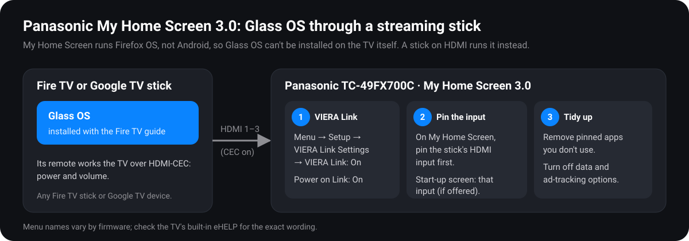

# Panasonic My Home Screen 3.0 guide

For Panasonic smart TVs running **My Home Screen 3.0**. Example: the **TC-49FX700C** (2018). Other Panasonic models from about 2017–2019 with the same interface should work the same way.

## Read this first: why Glass OS can't run on the TV itself

Panasonic's My Home Screen is built on **Firefox OS**, not Android. That means:

- **No Android apps.** Glass OS is an Android app, so there's nothing to install it into.
- **No ADB and no developer mode.** The Fire TV tools in this repo (`debloat.ps1`, `build.ps1`, `set-home.ps1`) can't connect to it. We found no supported sideloading or developer mode for this platform; Mozilla discontinued Firefox OS.
- **The home screen can't be replaced.** You can rearrange and remove the tiles on it, but not swap it for another app.

So, for the Glass OS experience on this TV, **run Glass OS on a small streaming stick plugged into the Panasonic**. Then set the TV up so the stick feels built in: it turns on with the TV, and the stick's remote controls the TV's power and volume. This guide covers both halves.

**What you need:**

| Item | Notes |
|---|---|
| A streaming stick that runs Android | **Fire TV stick on Fire OS 6 or 7** is the tested path. A Google TV device (Chromecast with Google TV, Google TV Streamer, onn 4K) also works with the [porting guide](PORTING.md) edits. Avoid **Vega OS** Fire TV devices, which can't run Android apps. |
| A free HDMI port on the TV | The FX700 has three. Any one works. |
| The stick's power adapter | Plug it into the wall, not the TV's USB port. The stick then stays ready and boots faster. |
| A Windows laptop on the same Wi-Fi | For the setup scripts, as in the [Fire TV guide](FIRE-TV.md). |

---

## Part 1: Set up the stick with Glass OS

1. Plug the stick into an HDMI port on the Panasonic and power it from the wall.
2. Switch the TV to that input. Press **INPUT AV** on the Panasonic remote and pick the HDMI port.
3. Finish the stick's own setup (Wi-Fi, account).
4. Follow the **[Fire TV guide](FIRE-TV.md)** from step 1 to step 7. It's identical on a stick, with three differences:
   - The **HDMI tiles** won't appear in Glass OS's grid, because a stick has no inputs. That's expected.
   - The **brightness slider** won't change anything, because a stick has no backlight. Use the Panasonic's own picture menu instead.
   - **Debloat** finds a slightly different set of apps. Lines for apps your stick doesn't have just say `skip`.

**On a Google TV device**, follow the [porting guide](PORTING.md) instead. Its §10 is a 15-minute quick-start for exactly this.

## Part 2: Make the Panasonic feel like it runs Glass OS

Menu names below come from Panasonic's manuals and help pages for this generation, and may differ slightly by firmware. If something isn't where it's described, press **HELP** on the Panasonic remote to open the built-in **eHELP** manual, and search for the item name.

### 2.1 Turn on VIERA Link (HDMI-CEC)

VIERA Link is Panasonic's name for HDMI-CEC. It lets the stick and the TV control each other.

1. Press **MENU** on the Panasonic remote, then go to **Setup → VIERA Link Settings**.
2. Set:
   - **VIERA Link: On**
   - **Power on Link: On.** The TV turns on and switches to the stick's input when the stick wakes up.
   - **Power off Link: On.** The stick sleeps when you turn the TV off.

Then turn on CEC on the stick:

| Stick | Setting |
|---|---|
| Fire TV | **Settings → Display & Sounds → HDMI CEC Device Control: ON** |
| Google TV | **Settings → System → Inputs → Consumer Electronic Control (CEC): ON**, with *Auto power on* and *TV auto power off* |

**Result:** the stick's remote turns the TV on and off and, on most setups, controls its volume. Pressing **Home** on the stick's remote opens Glass OS, so you rarely need the Panasonic remote at all.

### 2.2 Start on the stick's input

Panasonic's manuals describe a **my Home Screen setting for the screen shown when the TV turns on**. Where your firmware offers it:

1. Press **HOME** on the Panasonic remote, then open the options (the **OPTION** button, or the settings icon on My Home Screen).
2. Look for **my Home Screen Settings → Start-up screen** (wording varies).
3. Choose the **HDMI input the stick is on**, or **Last viewed**, which works too if you always leave the TV on the stick.

If there's no such option, **Power on Link** from 2.1 does the same job whenever you turn things on with the stick's remote.

### 2.3 Pin the stick's input to My Home Screen

So you can reach it in one press with the Panasonic remote:

1. Switch to the stick's input.
2. Press **HOME**, highlight the input's tile (or use **Pin to home** from the options), and **pin** it.
3. Move it to the front: highlight it, open the options, choose **Move**, and place it first.

### 2.4 Tidy up My Home Screen

The Panasonic's own apps can't be uninstalled or "debloated" like Fire TV's, but you can **remove their tiles** so the home screen only shows what you use:

1. Press **HOME**.
2. Highlight a tile you don't use, open the options, and choose **Remove from home** (or **Unpin**).
3. Repeat. The apps stay available under **Apps** if you ever need one.

### 2.5 Privacy and data options

Panasonic smart TVs of this era include online data and viewing-information services, plus advertising-related settings. Look under **MENU → Network** and **MENU → Setup** for items about data services, viewing information, or advertising. Turn off anything you don't want; it doesn't affect the stick.

The exact names vary by region and firmware; eHELP lists them for your model.

---

## Day-to-day use

| You want to… | Do this |
|---|---|
| Turn everything on | Press any button on the **stick's** remote. Power on Link wakes the TV on the right input. |
| Get to Glass OS | **Home** on the stick's remote |
| Watch antenna TV or another HDMI device | **INPUT AV** on the Panasonic remote, or the pinned tile on My Home Screen |
| Change picture settings | The **Panasonic** remote's **MENU → Picture** |
| Turn everything off | Power on the stick's remote. Power off Link puts both to sleep. |

## Undo

- **Panasonic:** set **VIERA Link** settings back, re-pin any tiles you removed (**HOME → Apps → pin**), and change the start-up screen back. Nothing on the TV itself was modified.
- **Stick:** use the [Fire TV guide's undo section](FIRE-TV.md#9-undo-everything), or the porting guide's undo for Google TV.

## Sources

- [Panasonic: "The VIERA home screen takes a leap in evolution with Firefox OS"](https://blogs.panasonic.com.au/consumer/the-viera-home-screen-takes-a-leap-in-evolution-with-firefox-os/)
- [Expert Reviews: Panasonic Firefox OS My Home Screen 2.0 hands-on](https://www.expertreviews.co.uk/?p=1402786)
- [Liliputing: "This is what Firefox OS looks like on TVs"](https://liliputing.com/2015/05/this-is-what-firefox-os-looks-like-on-tvs.html)
- [Panasonic help: How to turn on HDMI control on the TV](https://help.na.panasonic.com/answers/how-to-turn-on-hdmi-control-on-the-tv/)
- [Panasonic help: How to connect and use VIERA Link / CEC](https://help.na.panasonic.com/answers/how-to-connect-and-use-viera-link-hdavi-control-ez-sync-cec)
- [Panasonic eHELP example (TC-xxES600)](https://help.na.panasonic.com/wp-content/uploads/2023/02/TC32ES600_40ES600_49ES600_TQBEHELP_ENG.pdf): VIERA Link settings and the my Home Screen start-up option
